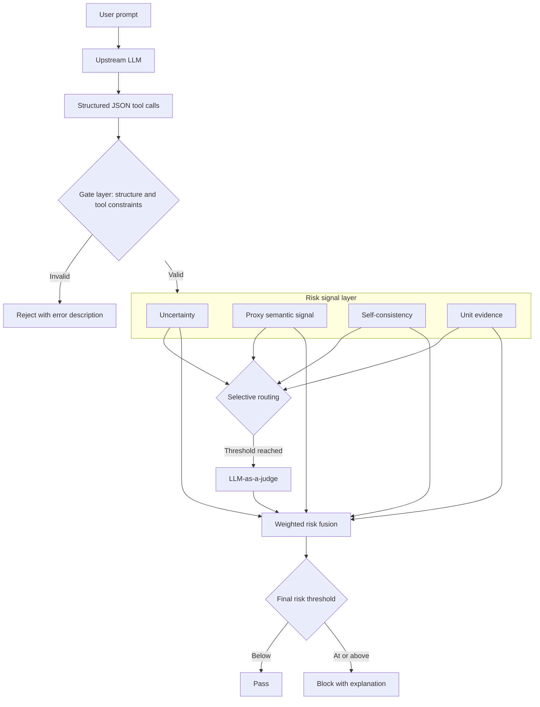
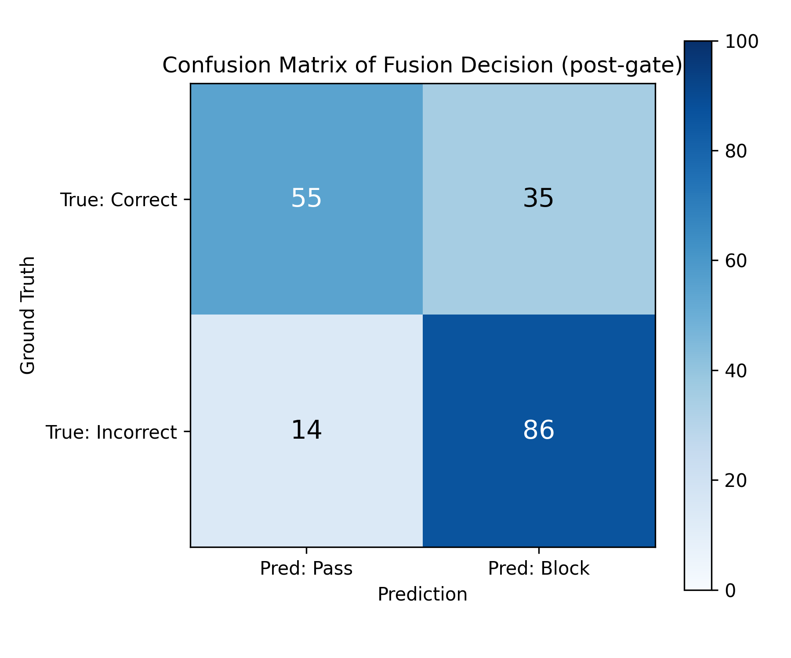
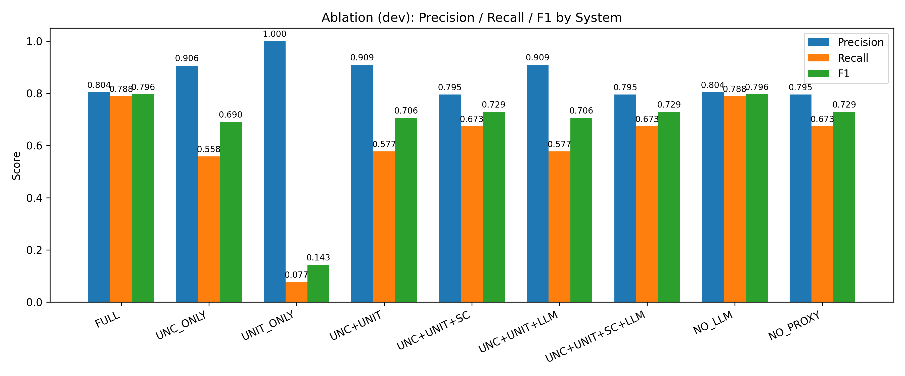

# LLM Hallucination Detection

**Post-hoc risk fusion and selective LLM-as-a-judge routing for structured tool calls.**

`Python` · `Hugging Face` · `Sentence Transformers` · `Ollama` · `LLM evaluation`

A research prototype for detecting unreliable function calls in a robot-command setting. It combines uncertainty, self-consistency, tool/parameter checks, unit mismatch, and an LLM judge. Models are not fine-tuned by this pipeline.

## Research focus

My work focused on studying hallucination-detection approaches and developing and evaluating a detection workflow for structured outputs. The repository contains the project implementation, calibration settings, prompts, ground-truth annotations, and analysis scripts. Existing project material is retained; no claim of sole authorship of external models or libraries is made.

## Detection workflow



Adapted from the evaluation architecture in the project presentation (slides 10 and 12), with routing inputs checked against the supplied implementation. The gate rejects malformed or invalid tool calls before risk fusion.

The frozen configuration defines the weighted risk score:

```text
risk = 0.30 × uncertainty + 0.20 × self_consistency
     + 0.20 × llm_risk + 0.25 × unit_mismatch + 0.05 × proxy_risk
```

Thresholds and model settings are recorded in [`config/frozen.yaml`](config/frozen.yaml). Development calibration and frozen test evaluation have separate scripts.

## Repository evidence

| Material | Included |
| :--- | :--- |
| Development annotations | 100 records in `data/dev/gt/gt_dev.jsonl` |
| Test annotations | 200 records in `data/test/gt/gt.jsonl` |
| Prompts and tool schemas | `data/*/prompts/`, `util/tools/` |
| Detection implementation | `src/fa_eval/`, `scripts/pipeline/` |
| Analysis | Threshold sweeps, routing comparison, ablation and plotting scripts |

These are annotation counts. The original presentation provides historical result figures, included below. The supplied code snapshot does **not** contain the original generated case files or final metric CSVs. Regenerated outputs may differ from the original run; annotations must be checked against the actual generated cases before treating them as a valid evaluation set.

## Results from the original presentation

The original experiment used 200 test samples and reported 10 gate failures. The confusion matrix covers the remaining **190 post-gate cases**:



Of the 100 incorrect cases in this matrix, 86 were blocked and 14 passed. Of the 90 correct cases, 55 passed and 35 were blocked. This illustrates the detection/false-alarm tradeoff in the prototype; these are historical presentation results, not a fresh benchmark run.

The development-set ablation compares the signal combinations:



The full system and the `NO_LLM` variant have the same displayed development-set scores. This figure does not demonstrate an incremental benefit from the LLM judge in that setting. See [experiment notes and figure provenance](docs/EXPERIMENTS.md) for the risk-signal and stability plots, dataset-denominator clarification, and reproduction limits.

## Reproduce

Use Python with a virtual environment and Bash (Linux or WSL). Model-backed stages require the relevant local/Hugging Face models and an Ollama service.

```bash
git clone https://github.com/Kylie08ky/llm-hallucination-detection.git
cd llm-hallucination-detection
python3 -m venv .venv
source .venv/bin/activate
pip install -r requirements.txt
export PYTHONPATH=src
```

See the [reproduction notes](docs/REPRODUCTION.md) for case generation and annotation commands. Once the case files and their aligned ground truth are available:

```bash
bash scripts/run/run_dev_pipeline.sh     # Development calibration
bash scripts/run/run_test_frozen.sh      # Frozen test settings
```

The requirements describe the original project and are not a fully pinned environment. Publication validation is documented in [VALIDATION.md](VALIDATION.md); a full model-backed evaluation has not been rerun for this upload.

## Scope and provenance

This is a research prototype for a limited tool vocabulary, not a universal hallucination detector. Its thresholds depend on the task, model, and data. Based on the FA3940 project snapshot supplied by the repository owner; original code and configuration are preserved. No repository-wide license was present in that snapshot, and none is added here.
