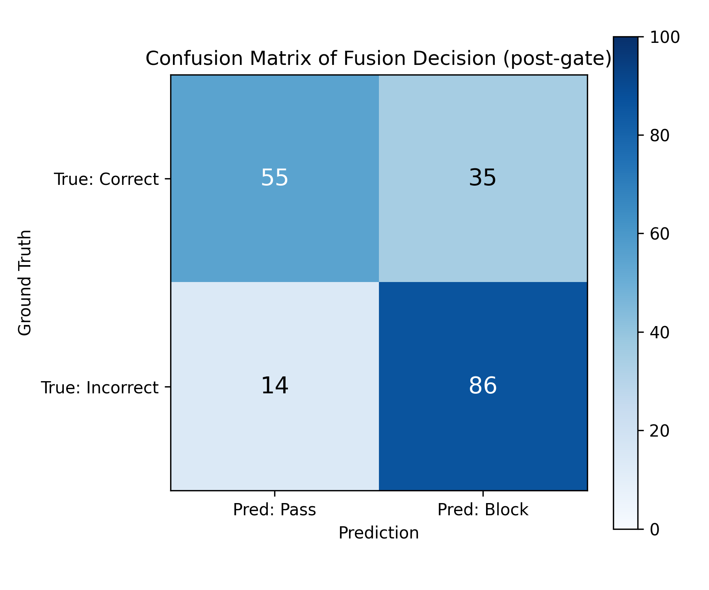
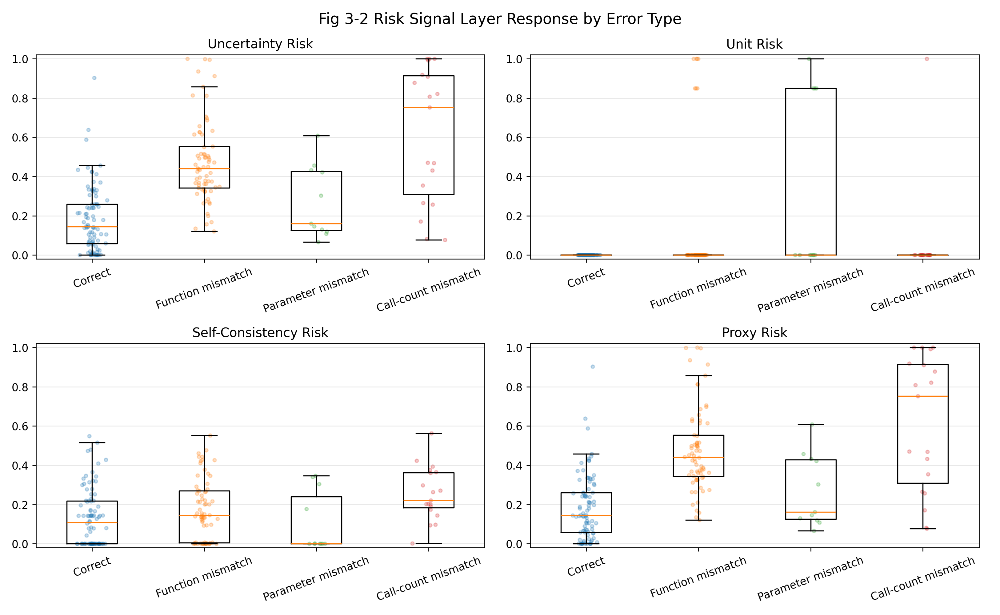
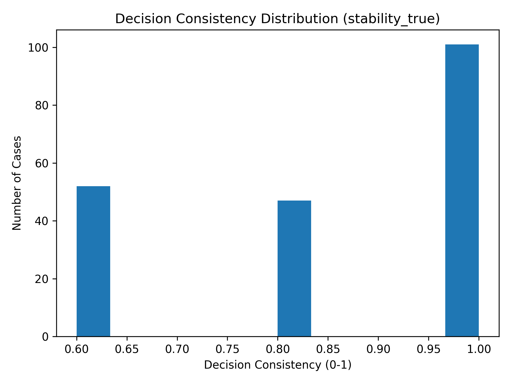
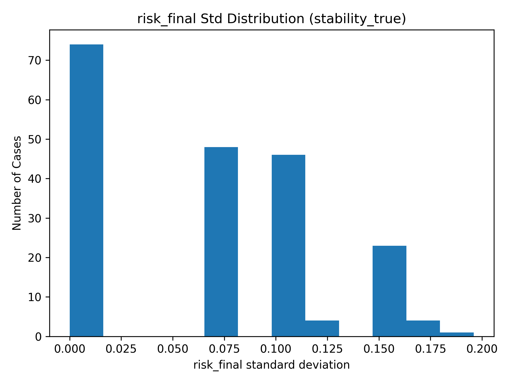
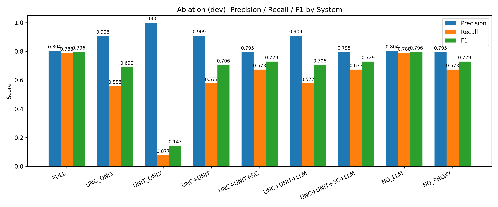

# Experiment notes and figure provenance

Figures below are extracted unchanged from the project owner's **Thesis Presentation**, dated 2026-03-04. They record the original experiment and have not been recomputed for this public snapshot. Only the technical figure objects are included; the full presentation and its personal/institutional identity pages are not published.

## Architecture

The README diagram adapts slides 10 and 12: an upstream LLM emits tool calls, a gate checks validity, risk modules supply signals, selected cases use an LLM judge, and weighted fusion produces the final decision. The executable implementation and `config/frozen.yaml` govern exact behavior.

## Fusion decision: slide 16

The matrix sums to 190: 90 correct cases (55 pass, 35 block) and 100 incorrect cases (14 pass, 86 block). With incorrect/blocked as the positive class, the matrix gives precision 86/121 = 71.1%, recall 86/100 = 86.0%, and F1 172/221 = 77.8%. These calculations are post-gate only.

**Denominator clarification:** the slide prose reports 200 total samples, 10 gate failures, and 190 post-gate samples, but also labels a 90/110 distribution as post-gate even though it sums to 200. The public overview uses the explicit 190-case matrix and keeps gate failures separate. Without the original per-case CSVs, the slide's prose cannot be reconciled further.

## Signal behavior: slide 17

The plots show distributions by error type, including overlapping labels. They should not be read as independent sample totals or causal proof that a signal improves the fused decision.

## Stability: slide 18

Repeated evaluations show nonzero risk variation and decision consistency below 1.0 for some cases. A frozen configuration alone does not make model-backed outputs deterministic.

## Development ablation: slide 19

The displayed FULL and NO_LLM scores are both precision 0.804, recall 0.788, F1 0.796. These are development-set results, not the post-gate test metrics above. They do not establish a gain from the LLM judge in this configuration. Routing cost/performance optimization remains future work in the presentation.

## Reproduction boundary

The repository includes prompts, 100 development annotations, 200 test annotations, model interfaces, detection scripts, and frozen settings. Original generated cases and metric CSVs were absent from the supplied code snapshot. Model generation and annotation alignment are required before rerunning the full pipeline. Figure extraction does not close that reproducibility gap.
